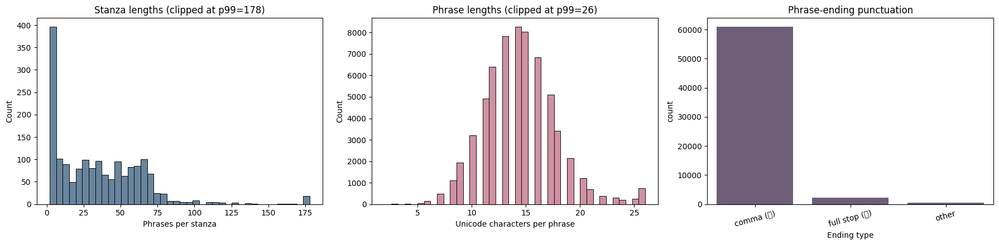
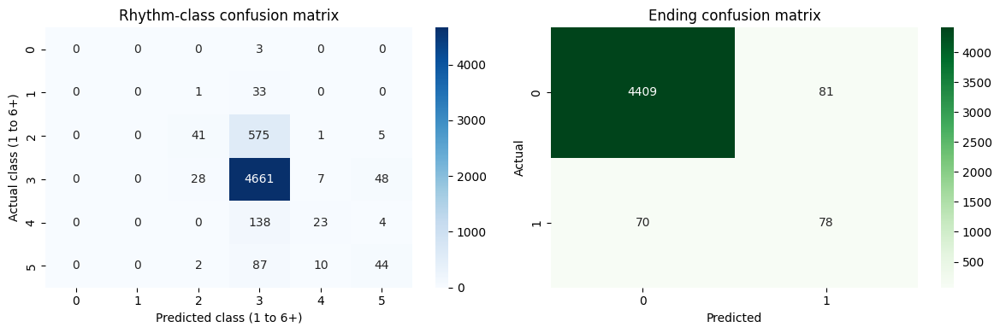

# Burmese Classical Poetry Generation

A deep-learning side project that continues **Burmese classical-style poetry** one phrase at a time. You give it a Burmese poetic phrase, and it generates the next phrase, the next few phrases, or the rest of the stanza.

Burmese spacing does not reliably mark word boundaries, so the model works with **syllable-like units** in the written text. Special `<PHRASE_END>` and `<STANZA_END>` tokens let the model choose phrase and stanza lengths itself instead of following a fixed template.

> **Status:** complete research prototype. The final model was chosen on validation using rules fixed in advance, then evaluated **once** on a held-out test split of 161 unseen poems.

## Why I chose this project

I wanted to see whether a model could continue a Burmese poem while picking up on its rhythm and rhyme. Classical Burmese verse made this an interesting test: four-syllable units are common in the material I collected, and a rhyme can connect the end of one line to a syllable inside the next. [Sarkisov's study of Burmese metre](https://doi.org/10.28995/2686-7249-2021-2-135-162) describes four-syllable lines and internal rhyme in early Burmese verse. My corpus also includes shorter phrases and stanzas of very different lengths.

I used gated recurrent networks because the task is sequential: the preceding syllables and phrases give clues about what should come next. LSTM and GRU models let me test whether a compact recurrent baseline could learn those cues from a modest corpus. I compared a one-phrase baseline with models that had longer context, attention and explicit rhyme, rhythm and ending objectives. Rhyme can span phrase boundaries, so I measured how often the models preserved it rather than assuming recurrence would be enough.

## How I built the dataset

I compiled Burmese classical verse into an Excel workbook, keeping the original phrase order. Each row holds up to five consecutive phrases and a boundary marker. I resolved ambiguous endings in a separate review sheet, then joined consecutive rows until the stanza-ending marker. The same workbook format also accommodates complete poems without explicit stanza breaks. The project files do not identify the source edition for each poem. Document those sources and verify redistribution rights before sharing the corpus publicly.

For modelling, I checked Unicode and punctuation, cleaned citation artefacts from a copy, preserved repeated phrases that could be intentional refrains, and deduplicated complete sequences. A custom segmenter groups Burmese combining signs and consonant stacks into syllable-like units. I split complete sequences before creating overlapping examples and built the vocabulary from the training split. This keeps windows from the same source sequence in one split. See the [dataset schema](data/README.md) for the workbook layout and expected path.

---

## Highlights

- **Data pipeline with validation checks.** Rebuilds 1,722 stanza sequences from a chunked Excel workbook, with assertions that no phrase is lost. Removes 120 duplicate copies (1,602 unique sequences remain) and cleans citation artefacts on a *copy*, so the original text can still be audited.
- **Custom Burmese syllable segmenter.** A regex rule keeps stacked consonants, medials, killed finals and dot-below forms together (for example, `နှင့်` and `တည့်` stay whole, and `ကျွန်တော်` splits correctly into `ကျွန်` + `တော်`).
- **Leakage-safe split.** Whole poems are assigned to train / validation / test (1,281 / 160 / 161) *before* any overlapping training examples are created. The vocabulary is built on training data only (2,974 syllables, 0.51% unknown on validation).
- **Controlled experiments.** LSTM vs GRU → attention with 4-phrase context → multi-task prosody heads → a 4-way ablation → a hybrid generator with separate rhyme and stanza-ending controllers.
- **Evaluation beyond accuracy.** Masked cross-entropy and perplexity, phrase-length Jensen–Shannon divergence, rhyme consistency, repetition-loop rate, candidate ranking (MRR, Recall@5), and majority-class baselines with macro-F1. The notebook includes a protocol for future blind human ratings.

## Pipeline


## Data at a glance



- 63,685 phrases. The median stanza has 31 phrases, but lengths range from 2 to 561.
- **79.8%** of phrases have four syllables, so the model should learn this pattern from the data rather than have it forced on it.
- 256,448 syllable tokens and 3,185 unique syllables. A quarter of them appear only once.

*(The Burmese punctuation labels on the right-hand chart show as boxes because the plotting font had no Myanmar glyphs.)*

## Final result (held-out test split)

The **GRU baseline** (one previous phrase as context) was selected on validation and then evaluated once on test:

| Measure | Validation | **Test** |
|---|---|---|
| Syllable cross-entropy (95% stanza bootstrap CI on test) | 5.101 | **5.064** (4.970–5.150) |
| Syllable perplexity | 164.1 | **158.2** |
| Continuation MRR / Recall@5 (true phrase vs 9 distractors) | 0.478 / 73.8% | **0.498 / 73.0%** |
| Rhyme consistency | 52.2% | **50.7%** |
| Repetition loops | 4.2% | **4.7%** |
| Stanza-ending F1 | 0.807 | **0.803** |

The selected model produced similar scores on validation and on this held-out split.

### How the candidates compared (test, same examples for every model)

| Model | Syllable CE ↓ | MRR ↑ | Rhyme consistency ↑ | Repetition loops ↓ |
|---|---|---|---|---|
| **GRU baseline (1 phrase)** | **5.064** | 0.498 | **50.7%** | **4.7%** |
| Context Attention GRU (4 phrases) | 5.086 | 0.480 | 43.2% | 8.5% |
| Token-only anchor/recency GRU | 5.116 | **0.502** | 47.4% | 11.9% |

## What I learned

1. **The simplest model won.** All three models are within the bootstrap interval on cross-entropy. The GRU baseline's real advantage is that it rhymes more and loops about half as often. Giving the model more context, attention or extra prosody heads did not help.
2. **Accuracy hid class imbalance.** The rhythm head scored 83.5% accuracy, but always predicting "four syllables" already scores 83.1%. Macro-F1 and confusion matrices showed that the auxiliary heads mostly predicted the majority class:

   

3. **Extra controllers did not pay off.** The hybrid reranker raised rhyme on validation but also raised repetition, so it failed its pre-set rule. On test it was worse than plain sampling, which confirmed the rejection. A separate ending controller (test F1 0.73) was weaker than the GRU's own stopping signal (0.80).
4. **Fixing the evaluation protocol before using test mattered.** Earlier sections compared models on slightly different samples. Putting every candidate on one shared set gave a fair final comparison.

## Limitations and next steps

- **The logged Keras `loss` is scaled.** With `mask_zero=True`, Keras applies the padding mask again on top of the custom masked loss. Selection used the correct `masked_crossentropy` metric. The fix is a small layer that drops the mask before the output layer, which the next training run should include.
- **Single seed, automatic measures only.** The models are statistically close on cross-entropy. Rhyme is an orthographic approximation, and blind human ratings have not been collected yet.
- **Long generations drift** into generic formulaic phrases and sometimes repeat syllables.
- Next: run several seeds, try n-gram-blocked decoding, and test a hierarchical (syllable → phrase) encoder. Any new choices will be made on validation, because the test split has now been used once.

## Repository structure

```
.
├── README.md
├── requirements.txt
├── burmese_classical_poetry_chunked.xlsx       # original corpus in this private repository
├── poem.ipynb                                 # earlier notebook
├── data/
│   └── README.md                              # local dataset format and expected path
├── notebooks/
│   ├── burmese_poetry_generation.ipynb         # training and evaluation workflow
│   └── model_checkpoints/                      # trained weights (Keras .weights.h5)
│       ├── lstm_best / gru_best                # Section 6 baselines (GRU = final model)
│       ├── context_gru_attention_best          # Section 7
│       ├── prosody_gru_attention_best          # Section 8
│       ├── ablations/                          # Section 9 (4 variants)
│       └── hybrid/                             # Section 11 controllers
└── assets/                                     # figures used in this README
```

## Running it

```bash
conda create -n burmese-poetry python=3.10
conda activate burmese-poetry
pip install -r requirements.txt
```

Open [the final notebook](notebooks/burmese_poetry_generation.ipynb) in Jupyter with the kernel working directory set to `notebooks/`. It loads the existing workbook at the repository root. Reproducing the reported metrics or using the saved checkpoints requires the original corpus and its training vocabulary. A separate corpus can be used to train a new model after adapting the corpus-specific checks in the notebook.

- Sections 1–11 were run in one GPU session (TensorFlow 2.10, native Windows; about 12–16 seconds per epoch for the baselines and the attention model). Section 12 only loads the saved checkpoints, so it also runs on CPU (about 35 minutes on 2 cores).
- The trained weights are included in `notebooks/model_checkpoints/`. Run All retrains every model and overwrites them, so copy the folder first if you want to keep the published versions.
- The optional human-rating protocol uses `input()`. The reported results are from automated evaluation.

## Tech stack

Python · TensorFlow / Keras · pandas · NumPy · scikit-learn · matplotlib · seaborn
